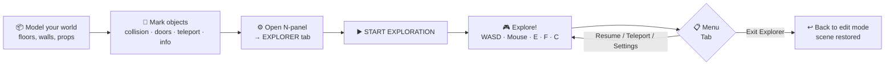
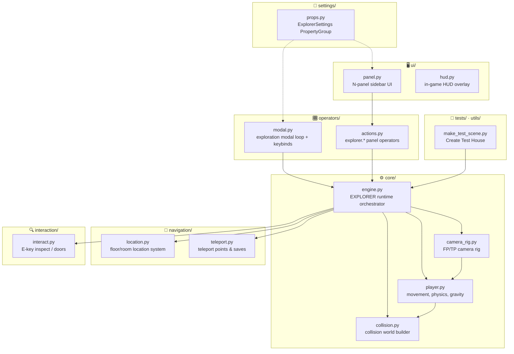
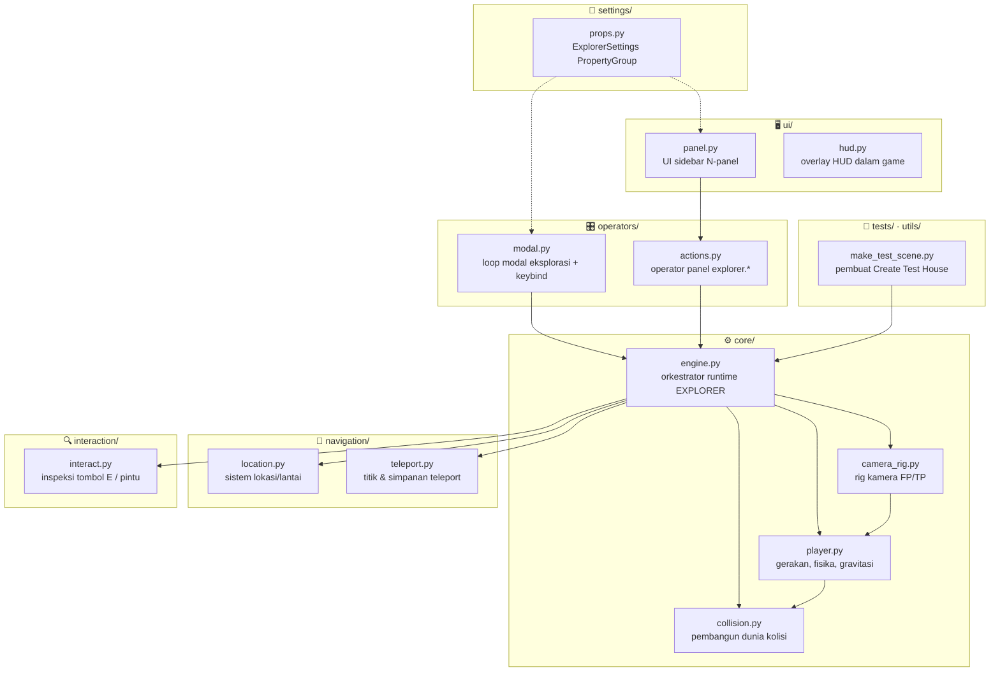

<!-- © 2026 VeryCoolApps — PT. Agra Karya Digital · EXPLORER v1.0.0 · PROPRIETARY — ALL RIGHTS RESERVED -->

  

# 🗺️ EXPLORER

### Walk through any Blender scene — first-person, game-style, no export required.

First-person 3D world exploration engine for Blender. Build collision from your
scene and put a player controller, physics, doors, teleports, and an inspector
on top — straight inside the 3D Viewport. No game engine. No export. No plugins.

**Author:** VeryCoolApps (PT. Agra Karya Digital) · **© 2026**

---

## 🌟 Features

| Feature | What it does |
|---------|--------------|
| 🕹️ **First & Third Person** | Toggle FP ↔ TP camera anytime with **C**. Mouse-wheel zoom in TP. |
| 🎮 **Game-style controls** | WASD movement, mouse look, Shift sprint, Ctrl crouch, Space jump. |
| 🧱 **Collision system** | Per-object and per-collection categories: `solid`, `walkable`, `none`. |
| ⚖️ **Physics-lite** | Gravity, ground detection, stairs, and multi-floor navigation. |
| 🚪 **Interactive doors** | Doors open/close on use, swing on a chosen axis, rebuild their own collision. |
| 🔍 **Object inspector** | Press **E** to inspect objects — reads text from `explorer_info`. |
| ⚡ **Teleport system** | Mark teleport points/targets, save positions in-game, jump instantly. |
| 🗺️ **Location & floor HUD** | On-screen floor/room/location driven by `explorer_floor` / `explorer_room`. |
| 🔦 **Flashlight** | Toggle a spotlight with **F**. |
| 🎛️ **Quality presets** | LOW / MEDIUM / HIGH collision quality and viewport performance. |
| 🚧 **World bounds** | Clamp the player inside scene bounds. |
| 🪂 **Fall respawn** | Falling below the world respawns you at a safe position (or spawn point). |
| 🧹 **Safe cleanup** | Exit restores the scene to its pre-exploration state. |

---

## ⚡ Quick Start — 60 seconds to explore

1. **Model your world** — floors, walls, props. Keep collision geometry simple.
2. Open the **N-panel sidebar** in the 3D Viewport → **EXPLORER** tab.
3. Set your **player settings** (eye height, speeds, gravity, mode).
4. Mark objects with the panel buttons or custom properties (see below).
5. Click **START EXPLORATION** — or hit **Create Test House** to try instantly.
6. Play! Press **ESC** to exit Explorer completely (**Tab** opens the menu; **P** pauses).

---

## 🎹 Keyboard Shortcuts

| Key | Action |
|-----|--------|
| **W / A / S / D** | Move forward / left / back / right |
| **Mouse** | Look around |
| **Shift** | Sprint |
| **Ctrl** | Crouch |
| **Space** | Jump |
| **C** | Toggle first-person / third-person camera |
| **F** | Toggle flashlight |
| **E** | Interact / inspect object |
| **Tab** | Open Explorer menu (pause) |
| **P** | Pause / resume exploration |
| **ESC** | Exit Explorer completely (with menu open: close / back out) |
| **Mouse wheel** | Zoom (third-person mode) |

---

## 📥 Installation

1. Download the EXPLORER package zip.
   The zip must contain the `explorer/` folder at its root.
2. In Blender: **Edit > Preferences > Add-ons > Install from Disk…**
3. Select the EXPLORER zip and click **Install from Disk**.
4. Enable the add-on by ticking the checkbox next to **EXPLORER**
   (it appears under the **3D View** or **Add-on** category).
5. Open a scene, switch to the **3D Viewport**, and press **N** to open the
   sidebar.

---

## 🏷️ Object Marking Guide

Mark objects using the panel buttons or by setting **custom properties**
directly on the object (Object Properties → Custom Properties) or on a
collection for batch marking.

| Property | Type | Values | Effect |
|----------|------|--------|--------|
| `explorer_collision` | string | `solid`, `walkable`, `none` | Collision category. `solid` blocks movement; `walkable` is a standable surface (floors, terrain); `none` ignores the object. Set on object or collection (collection applies to all children). |
| `explorer_door` | bool | `True` / `False` | Marks the object as an interactive door. |
| `explorer_door_axis` | string | `X`, `Y`, `Z` | Door swing axis. |
| `explorer_door_angle` | float | degrees | Door open angle. Hinge is at the object's origin. |
| `explorer_teleport` | bool or string | `True`, `False`, or label | Marks a teleport point (`True`) or a named teleport target (label string). |
| `explorer_teleport_label` | string | any text | Optional display name for the teleport point. |
| `explorer_info` | string | description | Text shown when inspecting the object with **E**. |
| `explorer_floor` | string/int | floor name or number | Floor label shown on the HUD. |
| `explorer_room` | string | room name | Room label shown on the HUD. |

**Spawn point:** create an Empty (or any object) named exactly
**`EXPLORER_SPAWN`**. It is recommended to use an Empty. The player's forward
direction is **−Y** of the object's local axes.

---

## 🧰 Panel Buttons

| Button | Description |
|--------|-------------|
| **Apply Collision to Selected** | Sets `explorer_collision` on the selected object(s) to the value chosen in the panel. |
| **Mark as Door** | Sets `explorer_door = True` (plus axis/angle properties) on the selected object. |
| **Mark as Teleport** | Sets `explorer_teleport` on the selected object, using the panel label. |
| **Set Info** | Stores the panel's info text into `explorer_info` on the selected object. |
| **Clear Marks** | Removes all `explorer_*` custom properties from the selected object(s). |
| **Refresh Collision World** | Rebuilds the collision world. Use after moving/editing geometry without restarting exploration. |
| **Create Test House** | Generates a simple test house (walls, floor, door) so you can try the controls immediately. |
| **Auto-Place Spawn** | Places a spawn point automatically (grid-scan fallback). |

---

## ⚙️ Settings Reference (EXPLORER panel)

| Section | Setting | Default |
|---------|---------|---------|
| **Movement** | Walk / Run / Crouch Speed, Crouch Height, Jump Height, Player Height & Radius, Eye Height, Mouse Sensitivity, Gravity, Step Height, Interact Distance | 3.0 / 5.5 / 1.5 m/s · 1.75 m height · 1.60 m eye · 9.81 m/s² |
| **Toggles** | Jump, Sprint, Crouch, Gravity, Collision, Invert Y | all ON except Invert Y |
| **Collision** | Enable Collision, Default Collision (`SOLID`/`WALKABLE`/`NONE`), Auto Refresh | SOLID |
| **Camera** | Camera Mode (FP/TP), Viewport Shading, Quality (LOW/MEDIUM/HIGH), Interact Distance | FP · Current · MEDIUM |
| **World** | World Bounds (0=off), Fall Respawn Z, Auto Spawn | 0 · −200 · ON |

---

## 🏗️ Architecture

- **`core/`** — the runtime: player controller, collision world, camera rig, engine lifecycle.
- **`operators/`** — `explorer.explore` modal operator captures input; `actions.py` holds every panel button.
- **`ui/`** — sidebar panel + in-game HUD.
- **`navigation/`** — location/floor tracking and teleports.
- **`interaction/`** — inspect and door interaction on **E**.
- **`settings/`** — `ExplorerSettings` PropertyGroup exposed in the panel.
- **`tests/`** — `Create Test House` scene generator.

---

## 🔧 Troubleshooting

- **No floor found / player falls through the world**
  - Check the floor is marked `walkable` (or `solid`), not `none`.
  - Check the spawn point is above a valid surface.
  - Use **Refresh Collision World** after editing geometry.
- **Spawn unsafe**
  - Make sure `EXPLORER_SPAWN` sits above a `walkable`/`solid` surface, not
    inside geometry, and inside world bounds.
- **Collision not updating after edits**
  - Click **Refresh Collision World** in the EXPLORER panel, or restart
    exploration.
- **Performance issues**
  - Switch quality preset to **LOW** / enable **Performance Mode**.
  - Simplify collision geometry (fewer faces, avoid high-poly meshes).
  - Mark large terrain as `walkable` so it doesn't generate complex blocking.

### Known limitations

- No VR support.
- No multiplayer / network play.
- Modifiers are **baked** into collision at collision-build time (apply or
  refresh after modifier changes).
- Instancing / duplis (collection instances, particle instances) are ignored.
- Doors rebuild their own collision each time they toggle — heavy scenes with
  many doors may see a small hitch.

---

## 📜 Changelog

### 1.0.0 — 2026-11-17

- Initial release.
- FP/TP camera modes, WASD + mouse look, sprint/crouch/jump.
- Collision categories (`solid` / `walkable` / `none`) on objects and collections.
- Gravity, stairs, multi-floor movement, world bounds, fall respawn.
- Interactive doors with per-axis swing and auto collision rebuild.
- Object inspector (`explorer_info`), teleports, floor/room HUD.
- Flashlight, quality presets, safe scene cleanup on exit.
- Panel tools: apply collision, mark door/teleport/info, clear marks, refresh
  collision, create test house.

---

## 🇮🇩 Bahasa Indonesia

### Jelajahi scene Blender apa pun — orang-pertama, gaya game, tanpa ekspor.

  

# 🗺️ EXPLORER

### Mesin eksplorasi dunia 3D first-person untuk Blender — langsung di 3D Viewport.

Mesin eksplorasi dunia 3D first-person untuk Blender. Bangun kolisi dari scene
Anda dan letakkan player controller, fisika, pintu, teleport, serta inspektor
di atasnya — langsung di dalam 3D Viewport. Tanpa game engine. Tanpa ekspor.
Tanpa plugin.

**Pembuat:** VeryCoolApps (PT. Agra Karya Digital) · **© 2026**

---

### 🌟 Fitur

| Fitur | Fungsi |
|-------|--------|
| 🕹️ **First & Third Person** | Alihkan kamera FP ↔ TP kapan saja dengan **C**. Zoom roda mouse di TP. |
| 🎮 **Kontrol gaya game** | Gerak WASD, arah mouse, lari Shift, jongkok Ctrl, lompat Space. |
| 🧱 **Sistem kolisi** | Kategori per-objek & per-koleksi: `solid`, `walkable`, `none`. |
| ⚖️ **Fisika ringan** | Gravitasi, deteksi lantai, tangga, dan navigasi multi-lantai. |
| 🚪 **Pintu interaktif** | Pintu terbuka/tutup saat dipakai, berayun pada sumbu pilihan, kolisi-nya dibangun ulang otomatis. |
| 🔍 **Inspektor objek** | Tekan **E** untuk memeriksa objek — membaca teks dari `explorer_info`. |
| ⚡ **Sistem teleport** | Tandai titik/target teleport, simpan posisi dalam game, pindah seketika. |
| 🗺️ **HUD lokasi & lantai** | Tampilan lantai/ruangan/lokasi di layar, digerakkan `explorer_floor` / `explorer_room`. |
| 🔦 **Senter** | Alihkan spotlight dengan **F**. |
| 🎛️ **Preset kualitas** | Kualitas kolisi & performa viewport: LOW / MEDIUM / HIGH. |
| 🚧 **Batas dunia** | Batasi pemain di dalam batas scene. |
| 🪂 **Respawn jatuh** | Jatuh di bawah dunia → respawn di posisi aman (atau titik spawn). |
| 🧹 **Cleanup aman** | Keluar mengembalikan scene ke kondisi sebelum eksplorasi. |

---

### ⚡ Mulai Cepat — 60 detik langsung menjelajah

1. **Model dunia Anda** — lantai, dinding, properti. Jaga geometri kolisi tetap sederhana.
2. Buka **sidebar N-panel** di 3D Viewport → tab **EXPLORER**.
3. Atur **pengaturan pemain** (tinggi mata, kecepatan, gravitasi, mode).
4. Tandai objek dengan tombol panel atau custom properties (lihat di bawah).
5. Klik **START EXPLORATION** — atau tekan **Create Test House** untuk coba langsung.
6. Main! Tekan **ESC** untuk keluar sepenuhnya dari Explorer (**Tab** membuka menu; **P** menjeda).

---

### 🎹 Peta Tombol

| Tombol | Aksi |
|--------|------|
| **W / A / S / D** | Maju / kiri / mundur / kanan |
| **Mouse** | Lihat sekeliling |
| **Shift** | Lari (sprint) |
| **Ctrl** | Jongkok (crouch) |
| **Space** | Lompat |
| **C** | Alihkan kamera first-person / third-person |
| **F** | Alihkan senter (flashlight) |
| **E** | Interaksi / periksa objek |
| **Tab** | Buka menu Explorer (jeda) |
| **P** | Jeda / lanjutkan eksplorasi |
| **ESC** | Keluar dari Explorer sepenuhnya (saat menu terbuka: tutup / kembali) |
| **Roda mouse** | Zoom (mode third-person) |

---

### 📥 Instalasi

1. Unduh paket zip EXPLORER.
   Zip harus berisi folder `explorer/` di root-nya.
2. Di Blender: **Edit > Preferences > Add-ons > Install from Disk…**
3. Pilih zip EXPLORER lalu klik **Install from Disk**.
4. Aktifkan add-on dengan mencentang kotak di samping **EXPLORER**
   (muncul di kategori **3D View** atau **Add-on**).
5. Buka scene, pindah ke **3D Viewport**, tekan **N** untuk membuka sidebar.

---

### 🏷️ Panduan Penandaan Objek

Tandai objek lewat tombol panel atau dengan mengatur **custom properties**
langsung pada objek (Object Properties → Custom Properties) atau pada koleksi
untuk penandaan massal.

| Properti | Tipe | Nilai | Efek |
|----------|------|-------|------|
| `explorer_collision` | string | `solid`, `walkable`, `none` | Kategori kolisi. `solid` menghalangi gerakan; `walkable` adalah permukaan yang bisa dipijak (lantai, medan); `none` mengabaikan objek. Bisa di objek atau koleksi (koleksi berlaku ke semua anak). |
| `explorer_door` | bool | `True` / `False` | Menandai objek sebagai pintu interaktif. |
| `explorer_door_axis` | string | `X`, `Y`, `Z` | Sumbu ayunan pintu. |
| `explorer_door_angle` | float | derajat | Sudut buka pintu. Engsel ada di origin objek. |
| `explorer_teleport` | bool atau string | `True`, `False`, atau label | Menandai titik teleport (`True`) atau target teleport bernama (label string). |
| `explorer_teleport_label` | string | teks apa pun | Nama tampilan opsional untuk titik teleport. |
| `explorer_info` | string | deskripsi | Teks yang tampil saat memeriksa objek dengan **E**. |
| `explorer_floor` | string/int | nama atau nomor lantai | Label lantai pada HUD. |
| `explorer_room` | string | nama ruangan | Label ruangan pada HUD. |

**Titik spawn:** buat Empty (atau objek apa pun) bernama persis
**`EXPLORER_SPAWN`**. Disarankan memakai Empty. Arah hadap pemain adalah
**−Y** dari sumbu lokal objek.

---

### 🧰 Tombol Panel

| Tombol | Keterangan |
|--------|------------|
| **Apply Collision to Selected** | Mengatur `explorer_collision` pada objek terpilih sesuai nilai di panel. |
| **Mark as Door** | Mengatur `explorer_door = True` (plus properti sumbu/sudut) pada objek terpilih. |
| **Mark as Teleport** | Mengatur `explorer_teleport` pada objek terpilih, memakai label panel. |
| **Set Info** | Menyimpan teks info panel ke `explorer_info` pada objek terpilih. |
| **Clear Marks** | Menghapus semua custom property `explorer_*` dari objek terpilih. |
| **Refresh Collision World** | Membangun ulang dunia kolisi. Pakai setelah memindahkan/mengedit geometri tanpa restart eksplorasi. |
| **Create Test House** | Membuat rumah uji sederhana (dinding, lantai, pintu) untuk langsung mencoba kontrol. |
| **Auto-Place Spawn** | Menempatkan titik spawn otomatis (fallback grid-scan). |

---

### ⚙️ Referensi Pengaturan (panel EXPLORER)

| Bagian | Pengaturan | Bawaan |
|--------|------------|--------|
| **Movement** | Kecepatan Jalan/Lari/Jongkok, Tinggi Jongkok, Tinggi Lompat, Tinggi & Radius Pemain, Tinggi Mata, Sensitivitas Mouse, Gravitasi, Tinggi Langkah, Jarak Interaksi | 3.0 / 5.5 / 1.5 m/s · tinggi 1.75 m · mata 1.60 m · gravitasi 9.81 m/s² |
| **Toggles** | Lompat, Lari, Jongkok, Gravitasi, Kolisi, Balik Sumbu Y | semua ON kecuali Balik Sumbu Y |
| **Collision** | Aktifkan Kolisi, Kolisi Bawaan (`SOLID`/`WALKABLE`/`NONE`), Refresh Otomatis | SOLID |
| **Camera** | Mode Kamera (FP/TP), Shading Viewport, Kualitas (LOW/MEDIUM/HIGH), Jarak Interaksi | FP · Saat Ini · MEDIUM |
| **World** | Batas Dunia (0=nonaktif), Z Respawn Jatuh, Spawn Otomatis | 0 · −200 · ON |

---

### 🏗️ Arsitektur

- **`core/`** — runtime: player controller, dunia kolisi, rig kamera, siklus hidup engine.
- **`operators/`** — operator modal `explorer.explore` menangkap input; `actions.py` menampung semua tombol panel.
- **`ui/`** — panel sidebar + HUD dalam game.
- **`navigation/`** — pelacakan lokasi/lantai dan teleport.
- **`interaction/`** — inspeksi dan interaksi pintu dengan **E**.
- **`settings/`** — `ExplorerSettings` PropertyGroup yang tampil di panel.
- **`tests/`** — generator scene **Create Test House**.

---

### 🔧 Pemecahan Masalah

- **Lantai tidak ditemukan / pemain jatuh menembus dunia**
  - Pastikan lantai ditandai `walkable` (atau `solid`), bukan `none`.
  - Pastikan titik spawn berada di atas permukaan yang valid.
  - Gunakan **Refresh Collision World** setelah mengedit geometri.
- **Spawn tidak aman**
  - Pastikan `EXPLORER_SPAWN` berada di atas permukaan `walkable`/`solid`,
    tidak di dalam geometri, dan di dalam batas dunia.
- **Kolisi tidak diperbarui setelah edit**
  - Klik **Refresh Collision World** di panel EXPLORER, atau restart eksplorasi.
- **Masalah performa**
  - Alihkan preset kualitas ke **LOW** / aktifkan **Performance Mode**.
  - Sederhanakan geometri kolisi (sedikit face, hindari mesh high-poly).
  - Tandai medan luas sebagai `walkable` agar tidak menghasilkan blokir kompleks.

### Keterbatasan yang Diketahui

- Tidak ada dukungan VR.
- Tidak ada multiplayer / permainan jaringan.
- Modifier **di-bake** ke dalam kolisi saat pembangunan kolisi (terapkan atau
  refresh setelah modifier berubah).
- Instancing / duplis (collection instance, particle instance) diabaikan.
- Pintu membangun ulang kolisinya sendiri setiap kali beralih — scene berat
  dengan banyak pintu bisa mengalami sedikit jeda.

---

### 📜 Riwayat Perubahan (Changelog)

#### 1.0.0 — 2026-11-17

- Rilis perdana.
- Mode kamera FP/TP, WASD + arah mouse, lari/jongkok/lompat.
- Kategori kolisi (`solid` / `walkable` / `none`) pada objek dan koleksi.
- Gravitasi, tangga, gerakan multi-lantai, batas dunia, respawn jatuh.
- Pintu interaktif dengan ayunan per-sumbu dan rebuild kolisi otomatis.
- Inspektor objek (`explorer_info`), teleport, HUD lantai/ruangan.
- Senter, preset kualitas, cleanup scene yang aman saat keluar.
- Alat panel: terapkan kolisi, tandai pintu/teleport/info, hapus tanda,
  refresh kolisi, buat rumah uji.

---

## © VeryCoolApps — PT. Agra Karya Digital

**© 2026 VeryCoolApps (PT. Agra Karya Digital) — All Rights Reserved**

| 📱 WhatsApp | ✈️ Telegram |
|:---:|:---:|
| [+62 815-1925-0845](https://wa.me/6281519250845) | [@VeryCoolApps](https://t.me/VeryCoolApps) |

> ⚠️ **PROPRIETARY LICENSE**
> This project **EXPLORER** is the exclusive intellectual property of **VeryCoolApps (PT. Agra Karya Digital)**.
> Copying, distributing, modifying, sublicensing, reverse engineering, or using any part of this
> software without explicit written permission is strictly prohibited and constitutes a violation
> of **UU No. 28/2014 tentang Hak Cipta** and applicable international IP law.
> For licensing inquiries: **wa.me/6281519250845**

*Powered by HermesClaw · Built in Indonesia 🇮🇩*
